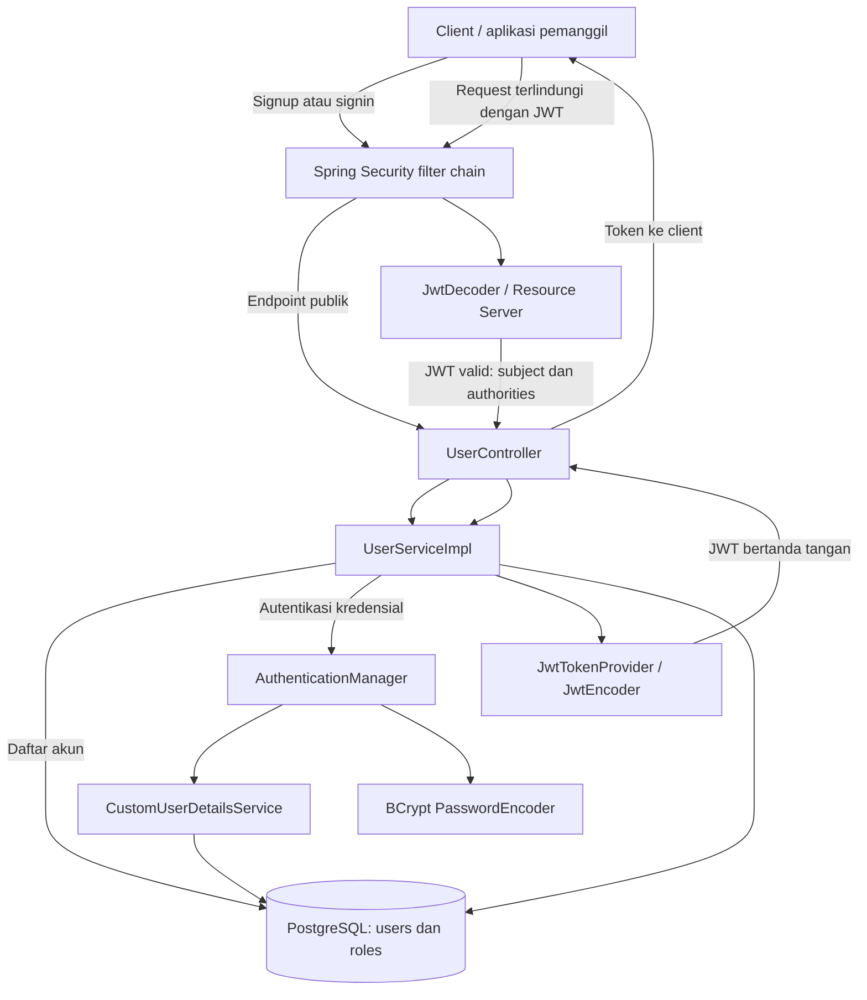
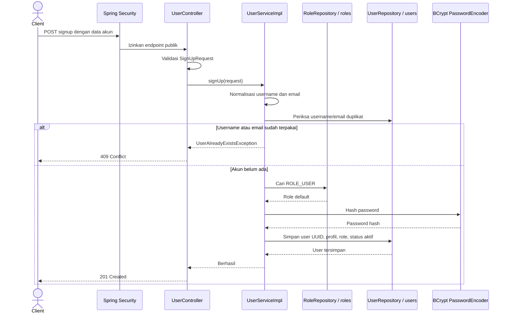

# Security Service

## Objective

Security Service adalah REST API yang mengelola identitas dan autentikasi pengguna untuk aplikasi lain. Service ini menyediakan pendaftaran akun, verifikasi kredensial, penerbitan JWT access token, dan perubahan password. Setelah signin, aplikasi klien dapat menyertakan JWT pada request selanjutnya agar service dapat mengenali pengguna tanpa meminta kredensial berulang kali.

Spring Security mengamankan request. JWT diterbitkan oleh service ini melalui encoder Spring Security dan diperiksa oleh Spring Security OAuth2 Resource Server.

## Teknologi

- Java 25 dan Maven
- Spring Boot 4.1.2
- Spring MVC untuk REST API
- Spring Security untuk autentikasi dan otorisasi, termasuk OAuth2 Resource Server untuk memvalidasi JWT
- Spring Data JPA dan Hibernate ORM untuk akses database PostgreSQL
- Jakarta Bean Validation untuk validasi request
- JWT bertanda tangan HS512, diterbitkan melalui Spring Security `JwtEncoder` dan ditandatangani dengan Nimbus JOSE
- BCrypt untuk hashing password
- Lombok untuk mengurangi boilerplate Java
- springdoc OpenAPI 3.2.0 dan Swagger UI
- JUnit, Mockito, AssertJ, dan Spring Boot Test untuk pengujian

## Gambaran arsitektur



Komponen utama:

- **`SecurityConfig`** menentukan endpoint publik, mengharuskan autentikasi pada endpoint lain, mengatur aplikasi stateless, dan mengubah claim `roles` menjadi authority Spring Security.
- **`UserController`** menangani HTTP request dan response untuk signup, signin, serta perubahan password.
- **`UserServiceImpl`** menjalankan aturan bisnis pengguna.
- **`CustomUserDetailsService`** mencari akun berdasarkan username atau email saat signin.
- **`JwtTokenProvider`** membuat JWT menggunakan Spring `JwtEncoder`.
- **Spring Security Resource Server** mengambil JWT dari request, memvalidasinya menggunakan `JwtDecoder`, lalu membuat authentication untuk request.
- **`UserRepository` dan `RoleRepository`** mengakses data pengguna dan role melalui JPA.

## Struktur package

```text
silupa.co.id.securityservice
├── config/          Konfigurasi aplikasi dan Spring Security
├── constants/       Konstanta aplikasi
├── controller/      REST endpoints
├── dto/
│   ├── request/     Data masuk dan validasi request
│   └── response/    Bentuk response API
├── entity/          Entity JPA dan converter database
├── repository/      Akses data Spring Data JPA
└── service/
    └── impl/        Implementasi aturan bisnis dan UserDetailsService
```

## Ringkasan refactor

- Project diperbarui ke Spring Boot 4.1.2 dan Java 25, termasuk penyesuaian namespace Jakarta.
- Filter JWT buatan sendiri diganti dengan mekanisme Spring Security OAuth2 Resource Server. Token tetap diterbitkan service menggunakan `JwtEncoder` Spring Security.
- Implementasi dan dependency JWT lama dihapus. Konfigurasi Swagger custom dihapus dan dokumentasi API menggunakan default springdoc.
- ID yang sebelumnya dihitung dari jumlah user diganti UUID agar tidak rawan bentrok.
- Model user dan role, validasi input, normalisasi username/email, penanganan kegagalan login, serta proses ganti password diperbaiki.
- Boilerplate getter/setter dan constructor dependency injection menggunakan Lombok; konstanta yang tidak digunakan dan anotasi `@Repository` redundant dihapus.
- Timestamp audit menggunakan `java.time.Instant`, dan deskripsi Maven menjelaskan fungsi service.
- Pengujian ditambahkan untuk service user, controller, validasi request, status aktif, dan penerbitan token.

## Alur signup

Endpoint: `POST /users/sign-up`. Endpoint ini publik dan tidak memerlukan autentikasi.



Aturan bisnis signup:

1. `@Valid` memeriksa field wajib, format username/email, panjang data, dan batas password sebelum aturan bisnis berjalan.
2. Setter request memangkas spasi tepi username dan email sebelum validasi berjalan; service kemudian mengubahnya menjadi huruf kecil agar identitas konsisten. Spasi tepi diterima dan dinormalisasi.
3. Username/email yang sudah terdaftar ditolak. Constraint unik database menjadi perlindungan tambahan saat ada signup bersamaan.
4. Role tidak diterima dari request. Akun baru selalu diberi `ROLE_USER`. Role tersebut harus sudah tersedia di tabel `roles`.
5. Password di-hash memakai BCrypt; password asli tidak disimpan.
6. User mendapat ID UUID, status aktif, serta tanggal dan identitas pembuat untuk audit.
7. Signup tidak menerbitkan JWT. Pengguna perlu signin setelah akun berhasil dibuat.

Signup sukses mengembalikan HTTP `201 Created`. Username atau email duplikat menghasilkan HTTP `409 Conflict`.

## Alur signin dan penerbitan JWT

Endpoint: `POST /users/sign-in`. Endpoint ini publik.

```mermaid
sequenceDiagram
    actor Client
    participant Security as Spring Security
    participant Controller as UserController
    participant Service as UserServiceImpl
    participant Manager as AuthenticationManager
    participant Details as CustomUserDetailsService
    participant DB as UserRepository / users
    participant Encoder as BCrypt PasswordEncoder
    participant Token as JwtTokenProvider / JwtEncoder

    Client->>Security: POST signin dengan username/email dan password
    Security->>Controller: Izinkan endpoint publik
    Controller->>Controller: Validasi SignInRequest
    Controller->>Service: authenticate(request)
    Service->>Service: Normalisasi identifier
    Service->>Manager: Autentikasi identifier dan password
    Manager->>Details: loadUserByUsername(identifier)
    Details->>DB: Cari username ATAU email tanpa membedakan kapital
    DB-->>Details: User dan role
    Details-->>Manager: UserPrincipal
    Manager->>Encoder: Cocokkan password dengan BCrypt hash
    alt Akun aktif dan password cocok
        Encoder-->>Manager: Valid
        Manager-->>Service: Authentication berhasil
        Service->>Token: Buat JWT untuk UserPrincipal
        Token-->>Service: JWT bertanda tangan
        Service-->>Controller: JWT
        Controller-->>Client: 200 OK berisi accessToken dan jenis token
    else Akun tidak ditemukan, nonaktif, atau password salah
        Manager-->>Service: AuthenticationException
        Service-->>Controller: Kegagalan autentikasi
        Controller-->>Client: 401 Unauthorized dengan pesan umum
    end
```

Identifier dinormalisasi sebelum dicari. Semua kegagalan kredensial menghasilkan pesan umum (`Invalid username/email or password`) agar respons tidak membocorkan apakah akun tertentu terdaftar. Password lebih dari 72 byte UTF-8 ditolak karena batas BCrypt.

Respons sukses berbentuk seperti berikut:

```json
{
  "success": true,
  "message": "Token ready",
  "payload": {
    "accessToken": "<JWT>",
    "tokenType": "Bearer"
  }
}
```

Untuk request selanjutnya, client menyertakan JWT di header `Authorization` menggunakan skema `Bearer`.

## Isi JWT dan validasi request

JWT memiliki tiga bagian yang dipisahkan titik:

```text
header.payload.signature
```

Header menyatakan algoritma tanda tangan HS512. Payload berisi claim berikut:

| Claim | Isi |
|---|---|
| `sub` | ID user berupa UUID |
| `roles` | Daftar authority ketika token diterbitkan, misalnya `["ROLE_USER"]` |
| `iat` | Waktu token diterbitkan |
| `exp` | Waktu token kedaluwarsa |

JWT ditandatangani, bukan dienkripsi. Pemegang token dapat membaca header dan payload; tanda tangan memungkinkan server mendeteksi perubahan yang tidak sah. Jangan memasukkan password, hash password, atau informasi rahasia lain ke claim.

Pada request terlindungi:

1. Spring Security Resource Server membaca header autentikasi dan mengambil JWT dari skema `Bearer`.
2. `JwtDecoder` memverifikasi tanda tangan HS512 dan memeriksa validitas waktu token, termasuk kedaluwarsa.
3. `JwtAuthenticationConverter` membaca claim `roles` dan membuat authority Spring Security.
4. Jika token valid, Spring Security menempatkan identitas dan authority pada `SecurityContext` untuk request tersebut, lalu meneruskan request ke controller.
5. Jika token tidak ada atau gagal divalidasi, request ditolak sebelum masuk ke controller.

Masa berlaku token diatur manual melalui `app.jwtExpiration` dalam milidetik (default tujuh hari). `app.jwtSecret` diatur langsung di `application.yml` dan harus berupa Base64 yang menghasilkan minimal 64 byte untuk HS512.

## Alur perubahan password

Endpoint: `POST /users/change-password`. Endpoint ini memerlukan autentikasi.

Request menerima `currentPassword` dan `newPassword`, bukan ID atau username target. Controller mengambil subject dari JWT dan service:

1. Mencari user berdasarkan ID pada claim `sub`.
2. Memastikan password saat ini cocok dengan BCrypt hash.
3. Menolak password saat ini yang melebihi batas BCrypt.
4. Meng-hash password baru dan menyimpan perubahan beserta waktu/pembuat modifikasi.

Password baru harus memenuhi validasi panjang dan batas 72 byte UTF-8. ID user dari client tidak dipakai untuk memilih akun yang akan diubah.

## Endpoint dan akses

| Endpoint | Akses | Tujuan |
|---|---|---|
| `POST /users/sign-up` | Publik | Membuat akun baru dengan role `ROLE_USER` |
| `POST /users/sign-in` | Publik | Memverifikasi kredensial dan menerbitkan JWT |
| `POST /users/change-password` | Autentikasi diperlukan | Mengubah password akun yang teridentifikasi oleh JWT |
| `/swagger-ui.html`, `/swagger-ui/**` | Publik | Swagger UI |
| `/v3/api-docs/**` | Publik | Dokumentasi OpenAPI |
| Endpoint lain | Autentikasi diperlukan | Endpoint aplikasi terproteksi |

Saat ini aturan URL mensyaratkan token valid untuk endpoint non-publik. Role sudah tersedia sebagai authority, tetapi belum ada pembatasan per role yang diterapkan pada endpoint tertentu (misalnya aturan khusus admin).

## Menjalankan aplikasi

Kebutuhan: JDK 25, Maven yang berjalan dengan JDK 25, dan PostgreSQL yang dapat diakses aplikasi.

Sebelum menjalankan aplikasi, buat key lokal di macOS/Linux:

```bash
openssl rand -base64 64
```

Salin hasilnya ke `app.jwtSecret` di `src/main/resources/application.yml`, menggantikan `REPLACE_WITH_BASE64_SECRET`. Atur port melalui `server.port` dan masa berlaku token melalui `app.jwtExpiration` pada file yang sama. Jangan commit key pribadi; konfigurasi key langsung di file ini hanya untuk penggunaan lokal.

```bash
mvn spring-boot:run
```

Aplikasi default berjalan pada port `3000`. Endpoint Swagger UI biasanya tersedia di `/swagger-ui.html`. Jangan menggunakan key atau kredensial database lokal maupun `ddl-auto: update` sebagai strategi deployment production; gunakan secret manager dan migrasi database yang ditinjau.

## Perubahan model dan persiapan database

- Primary key user sekarang UUID string dengan panjang hingga 36 karakter; pastikan schema baru menggunakan tipe/panjang yang sesuai untuk ID dan foreign key terkait.
- Entity `User` dan `Role` menggunakan nama kelas singular dengan `@Table(name = "users")` dan `@Table(name = "roles")`. Relasi wajib `User.role` menggunakan kolom `role_id`. Pastikan role `ROLE_USER` tersedia sebelum signup digunakan.
- Nama role unik.
- Field `active` dipetakan sebagai boolean aplikasi melalui converter yang tetap membaca format legacy seperti `1`/`0` dan `Y`/`N`.
- Nama kolom sekarang mengikuti nama field dan naming strategy Hibernate; `@Column` dipertahankan untuk batasan panjang, nullable, dan unik. Pastikan skema baru dibuat dari mapping aplikasi ini.
- Database lama belum dimigrasikan atau diverifikasi. Jika database dibuat ulang, siapkan data awal role termasuk `ROLE_USER` sebelum signup digunakan.

## Catatan keamanan dan batasan saat ini

- Token menyimpan snapshot role saat diterbitkan. Perubahan role atau status user tidak otomatis mengubah claim pada JWT yang sudah terbit.
- Perubahan password belum mencabut JWT yang sudah terbit. Token lama tetap dapat dipakai hingga kedaluwarsa kecuali ditambahkan mekanisme pencabutan, rotasi, atau pemeriksaan versi token.
- CORS dikonfigurasi terpusat di `SecurityConfig` dan saat ini mengizinkan semua origin (`*`) sesuai kebutuhan sementara; konfigurasi production sebaiknya membatasi origin ke aplikasi yang dipercaya.
- Relasi `User.role` tetap lazy secara default; query pencarian user untuk signin mengambil role secara eksplisit, sehingga lazy loading di luar transaksi tidak diaktifkan.
- Secret HS512 yang sama dipakai untuk menandatangani dan memvalidasi token. Jaga kerahasiaannya, jangan commit ke repository, dan rotasi dengan rencana yang mempertimbangkan token aktif.
- Endpoint admin atau operasi sensitif lainnya sebaiknya memiliki aturan otorisasi berbasis role secara eksplisit sebelum digunakan.
